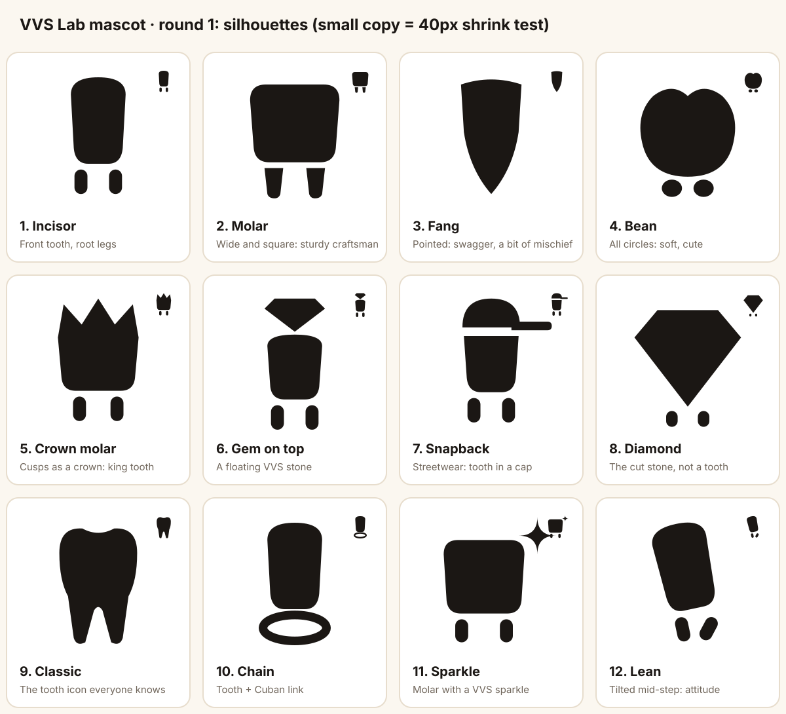
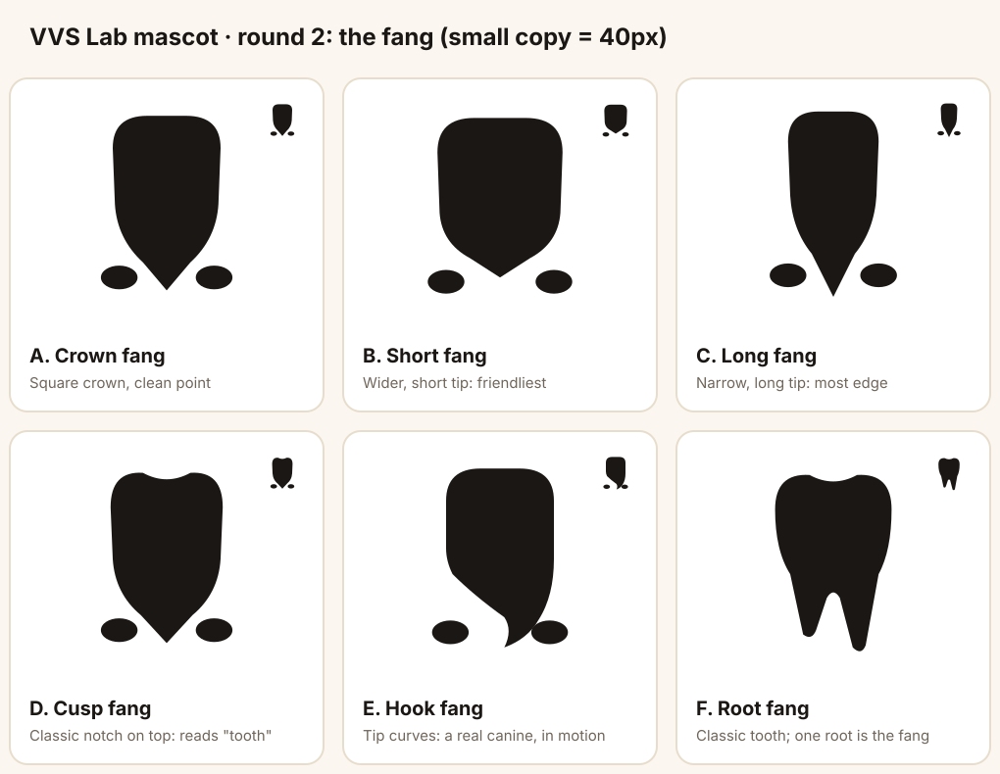
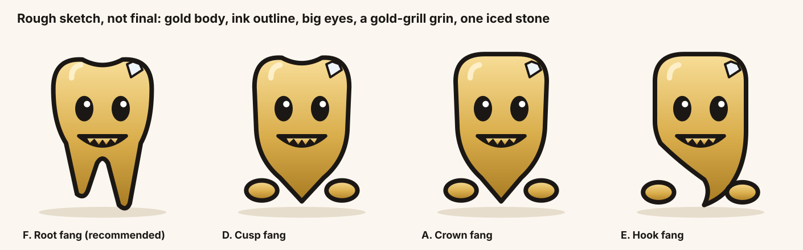
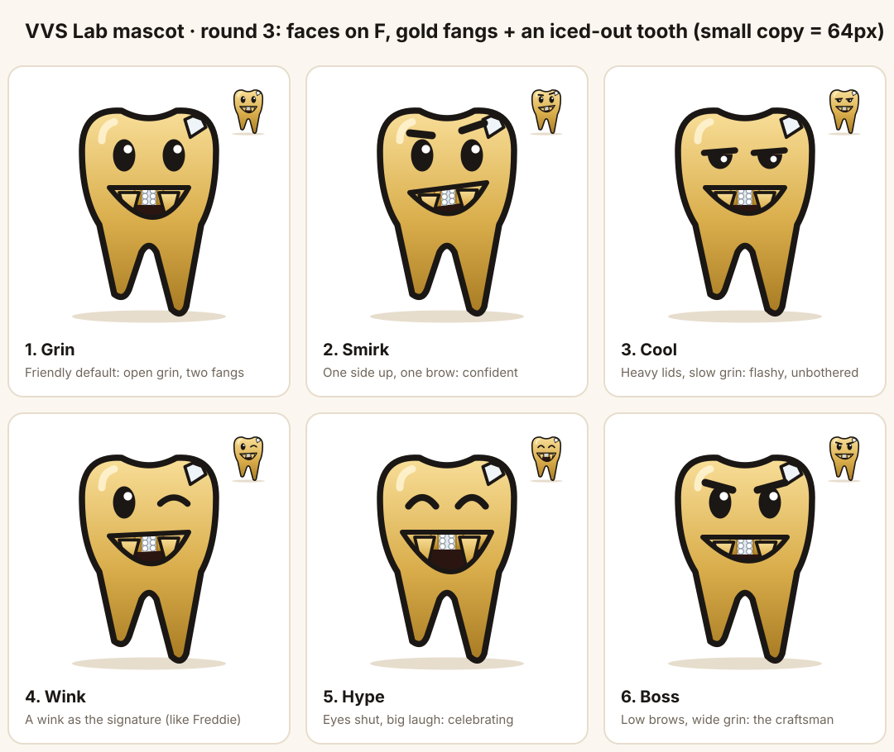

# VVS Lab mascot

Built the way character designers work: the job and personality first, then
the silhouette (shape only, no detail), then the face, then the model and
expression sheets. Each round is approved before the next starts.

## Brief

**Jobs (what it's for).** Welcome a new shop · celebrate wins (first design
request, first deposit, going live) · nudge near the end of the trial · soften
bad news (builder paused, win-back) · fill empty states in the dashboard.

**Audience.** Jewelers who make grillz: proud craftsmen in hip-hop and street
culture (Atlanta, Houston, NYC, LA), running small shops from their phones.

**Personality.**
- Three traits: **confident**, **flashy-proud**, **loyal** (on the shop's side).
- The contradiction: flashy on the outside, a **meticulous craftsman** inside,
  like a good jeweler. Never sloppy, never clownish.
- Goal: get every shop's builder shining and booked.
- Fear: losing its shine (a dull, tarnished smile). Useful for win-back.

**Shape language.** A sturdy, squared body (dependable craftsman) with rounded
corners (friendly), and one sharp accent for swagger (a fang, a sparkle, a
crown point). Avoid all-circles (reads cute and lazy) and all-triangles (reads
villain).

**Rules.** Reads as a tooth at 16–40px, in one colour. Gold is the body (the
metal); the product's red is never the body. One signature detail that's
always there (like Freddie's wink): candidates are a single iced stone, a
crown of cusps, or a 4-point sparkle. Detached limbs (Duo's feet) so it can
pose without hands.

## Round 1: silhouettes

Twelve shapes from primitives, each shown large and at 40px (the shrink test).
Source: `scripts/mascot-silhouettes.ts`.

What the shrink test says:
- **Read as a tooth at 40px:** 9 Classic (instantly), 5 Crown molar, 2 Molar,
  11 Sparkle.
- **Read as something else:** 1 Incisor, 10 Chain and 12 Lean become bars;
  3 Fang a leaf; 4 Bean an apple; 8 Diamond reads as a gem (clear, but not
  ours alone).

Recommendation: **9 Classic** as the body (ownable, instantly a tooth), with
**5's crown cusps** on top as the signature, the crown doubling as "the king
of your shop". Round 2 would try 4–6 versions of that hybrid with
proportions, the root legs and the stance, still in black.

## Round 2: the fang

You picked Classic, Fang and Smile; on brand fit (the hero and link-preview
images are gold fangs, the voice is confident with an edge) the fang leads,
built on Classic's crown so it still reads as a tooth.

Source: `scripts/mascot-round2.ts`. What it shows:
- **A–E read as shields or guitar picks at 40px.** A point on its own doesn't
  say "tooth"; the crown notch (D) helps but not enough.
- **F (Root fang) is the only one that still reads as a tooth at 40px.** The
  roots become legs, so it stands and walks without extra feet, and the
  longer root gives it a stance.
- In F the fang lives in the legs, which is subtle. Recommendation: carry the
  fang in the **face**: the grin wears gold fang caps like the hero image, so
  the smile (your third pick) and the fang both stay.

## Round 3: the face

Chosen body: **F, Root fang**. The grin carries the grillz: two obvious gold
fangs and one iced-out tooth in the centre, set against a dark mouth so they
read even at 64px (avatar size).

Source: `scripts/mascot-round3.ts`. Six faces, one personality each: Grin
(friendly default), Smirk (confident), Cool (flashy, unbothered), Wink (a
signature, like Freddie's), Hype (celebrating), Boss (the craftsman).
Expressions all come from the same parts later, so the pick is the
**resting** face; the others become the expression sheet.

Next rounds: 4 colour (gold body, ink outline, one iced stone) ·
5 model sheet (front, ¾, side) and expression sheet (happy, celebrating,
nudging, sleepy/dull for win-back, thinking).
